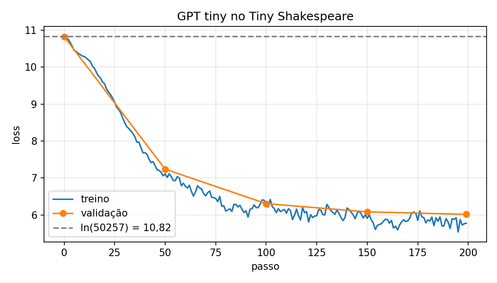

# Implementação do GPT-2 (124M): relatório técnico

Disciplina: LLM, CESAR School

Código-fonte: https://github.com/RonaldoTSM/gpt2-implementacao

Referências: material das Aulas 1, 2, 3, 5, 6 e 7 e Lab 1; vídeo *"Let's reproduce GPT-2 (124M)"* (Andrej Karpathy) e repositórios `karpathy/nanoGPT` / `karpathy/build-nanogpt`

---

## Sumário

1. [Visão geral e organização do código](#1-visão-geral-e-organização-do-código)

2. [Componentes da arquitetura](#2-componentes-da-arquitetura)

3. [Treinamento](#3-treinamento)

4. [Geração de texto](#4-geração-de-texto)

5. [Resultados obtidos](#5-resultados-obtidos)

6. [Relação entre teoria e prática](#6-relação-entre-teoria-e-prática)

7. [Reflexão individual](#7-reflexão-individual)

---

## 1. Visão geral e organização do código

| Arquivo | Conteúdo |
|---|---|
| `model.py` | Arquitetura: `GPTConfig`, `CausalSelfAttention`, `MLP`, `Block`, `GPT` (com `from_pretrained`, `configure_optimizers`, `generate`) |
| `train.py` | Dados (`DataLoaderLite`), agendamento de learning rate, loop de treino com acumulação de gradiente, precisão mista e DDP |
| `generate.py` | Geração de texto a partir dos pesos da OpenAI ou de um checkpoint próprio |
| `plot_loss.py` | Desenha a curva de loss (`loss.png`) a partir do `log.txt` gravado pelo `train.py` |
| `requirements.txt` | Versões exatas das bibliotecas usadas |

Como rodar:

```bash
python3 -m venv .venv && .venv/bin/pip install -r requirements.txt
.venv/bin/python generate.py --pretrained gpt2          # pesos oficiais da OpenAI
.venv/bin/python train.py --preset tiny --max_steps 200 # treino do zero (notebook)
.venv/bin/python plot_loss.py                         # curva de loss -> loss.png
.venv/bin/python generate.py --ckpt ckpt.pt --prompt "ROMEO:"
```

O GPT-2 é treinado para prever o próximo token a partir dos anteriores. A implementação reúne as etapas de representação dos tokens, transformação das sequências, cálculo da perda e atualização dos parâmetros.

Fluxo completo de um forward (B = batch, T = tamanho da sequência, C = 768, V = 50257):

```
idx (B,T) ─► wte (B,T,C) + wpe (T,C) ─► x (B,T,C)
          ─► 12 × Block [ x + Attn(LN(x)) ; x + MLP(LN(x)) ]
          ─► ln_f ─► lm_head ─► logits (B,T,V) ─► softmax ─► P(próximo token)
```

---

## 2. Componentes da arquitetura

### 2.1 `GPTConfig`: hiperparâmetros

| Campo | Valor (GPT-2 small) | Significado |
|---|---|---|
| `block_size` | 1024 | Janela de contexto máxima (tokens) |
| `vocab_size` | 50257 | 50.000 merges BPE + 256 bytes + `<\|endoftext\|>` |
| `n_layer` | 12 | Número de blocos empilhados |
| `n_head` | 12 | Cabeças de atenção por bloco |
| `n_embd` | 768 | Dimensão de cada vetor do fluxo residual |

Cada cabeça trabalha com `head_size = 768 / 12 = 64` dimensões.

### 2.2 Tokenização (`tiktoken`)

O modelo não vê caracteres, vê tokens BPE (Byte Pair Encoding). O BPE byte-level parte de representações dos 256 valores possíveis de byte e aplica combinações aprendidas de pares frequentes, formando unidades de tamanho variável. Exemplo:

```python
enc = tiktoken.get_encoding("gpt2")
enc.encode("Hello, I'm a language model,")
# [15496, 11, 314, 1101, 257, 3303, 2746, 11]  -> 8 tokens
```

"Hello" é um único token; " language" (com o espaço) é outro. Palavras raras viram vários tokens. O uso do mesmo tokenizador é necessário para preservar a correspondência entre os identificadores dos tokens e os pesos carregados (por exemplo, o índice 15496 corresponde a "Hello").

### 2.3 Embeddings: `wte` e `wpe`

- Entrada: `idx` de forma `(B, T)` com inteiros em `[0, V)`.
- `wte` (token embedding): tabela `(V, C)`. Cada identificador seleciona um vetor de 768 dimensões, cujos valores são aprendidos durante o treinamento.
- `wpe` (position embedding): tabela `(1024, C)`. A linha `t` representa "estar na posição t".
- Saída: `x = wte(idx) + wpe(pos)` com forma `(B, T, C)`. A soma usa broadcast: a mesma posição recebe o mesmo vetor de posição em todos os exemplos do batch.

Sem informação de posição, a self-attention é equivariante a permutações: embaralhar os tokens só embaralha a saída, então o modelo não enxerga a ordem. A máscara causal quebra essa simetria, mas não diz a cada token em que posição ele está. O Transformer original usava codificações senoidais; o GPT-2 aprende os vetores de posição (`wpe`).

### 2.4 `CausalSelfAttention`: a etapa de "comunicação"

A atenção permite que cada posição incorpore informações das posições anteriores.

Entrada / saída: `(B, T, C)` → `(B, T, C)`.

Passo a passo no código:

1. Projeção Q, K, V: `self.c_attn` é uma única `Linear(C, 3C)`; depois `split` separa em `q`, `k`, `v`, cada um `(B, T, C)`.

   - Query: representa a consulta realizada por uma posição
   - Key: representa a chave usada na comparação entre posições
   - Value: contém a informação agregada pela atenção

2. Divisão em cabeças: `view(B, T, nh, hs).transpose(1, 2)` → `(B, 12, T, 64)`. Agora `(B, nh)` funcionam como dimensões de batch e as 12 cabeças calculam em paralelo, com parâmetros próprios para aprender diferentes relações entre posições.

3. Scores: `q @ kᵀ` dá uma matriz `(T, T)` por cabeça: o elemento `(i, j)` é a afinidade do token `i` com o token `j`.

4. Escala por `1/√hs`: se `q` e `k` têm componentes de variância 1, o produto escalar de 64 termos tem variância 64. Scores grandes fazem o softmax saturar (quase one-hot) e os gradientes somem. Dividir por `√64 = 8` traz a variância de volta para ~1.

5. Máscara causal: posições `j > i` recebem `-∞`; após o softmax viram peso 0. O token na quinta posição só pode acessar as posições de 1 a 5. Isso é o que torna o modelo autoregressivo e permite treinar todas as T posições ao mesmo tempo sem acesso aos tokens futuros.

6. Softmax + média dos values: `att @ v` → `(B, nh, T, hs)`.

7. Concatenação das cabeças: `transpose(1, 2).contiguous().view(B, T, C)`.

8. Projeção de saída: `c_proj`, uma `Linear(C, C)` que mistura as cabeças e escreve no fluxo residual.

Exemplo de máscara (T = 4, pesos após softmax de uma cabeça):

```
          t1    t2    t3    t4
t1  [   1.00  0     0     0    ]
t2  [   0.40  0.60  0     0    ]
t3  [   0.10  0.70  0.20  0    ]
t4  [   0.25  0.25  0.25  0.25 ]
```

Cada linha soma 1; o triângulo superior é sempre zero.

No código os passos 3–6 estão numa única chamada, `F.scaled_dot_product_attention(q, k, v, is_causal=True)`, que calcula a mesma fórmula. Em GPU CUDA ela usa FlashAttention, que não monta a matriz T×T na memória. A versão manual comentada em `model.py` mostra a conta que a função faz.

### 2.5 `MLP`: a etapa de "computação"

Entrada / saída: `(B, T, C)` → `(B, T, C)`, aplicado a cada token separadamente (nenhuma troca entre posições).

```
Linear(768 → 3072) → GELU → Linear(3072 → 768)
```

- A expansão para 4× dá espaço para a rede representar muitas "características" intermediárias.
- GELU em vez de ReLU: é suave e deixa passar gradiente para entradas negativas, então não há neurônios "mortos". Usamos `approximate="tanh"` porque foi a versão usada pela OpenAI (era mais rápida em 2019), e precisamos dela para reproduzir os pesos.

Na atenção, cada posição combina informações de diferentes tokens; no MLP, a transformação é aplicada a cada posição separadamente.

### 2.6 `Block`: residual + LayerNorm (pré-norm)

```python
x = x + self.attn(self.ln_1(x))
x = x + self.mlp(self.ln_2(x))
```

- Conexão residual (`x + ...`): a saída de cada subcamada é somada à entrada. Na retropropagação, essa soma cria um caminho direto para o gradiente (`∂y/∂x = I + J`). É isso que permite empilhar 12 blocos e ainda treinar.
- LayerNorm: normaliza cada vetor de token para média 0 e variância 1 (com ganho γ e viés β aprendidos). Mantém as ativações numa escala controlada.
- Pré-norm (diferença para o paper Attention Is All You Need): a LayerNorm fica antes da sub-camada, dentro do ramo, e não depois da soma. Assim o caminho residual nunca passa por uma normalização. O GPT-2 também acrescenta uma LayerNorm final (`ln_f`) depois do último bloco.

### 2.7 `GPT`: o modelo completo

- `transformer.wte`, `transformer.wpe`, `transformer.h` (lista de 12 `Block`), `transformer.ln_f`, `lm_head`.
- Os nomes seguem o checkpoint do HuggingFace de propósito, para `from_pretrained` funcionar.

`lm_head`: `Linear(768 → 50257, bias=False)`. Transforma o vetor final de cada posição em 50257 logits, um por token do vocabulário. Softmax dos logits = probabilidade do próximo token.

Weight tying: `self.transformer.wte.weight = self.lm_head.weight`. A matriz de entrada e a de saída são o mesmo tensor. Intuição: tokens parecidos devem ter embeddings parecidos e também receber probabilidades parecidas na saída. Isso economiza 50257 × 768 ≈ 38,6M parâmetros, 31% do modelo.

Contagem de parâmetros (124M):

| Parte | Cálculo | Parâmetros |
|---|---|---|
| `wte` (compartilhado com `lm_head`) | 50257 × 768 | 38,6M |
| `wpe` | 1024 × 768 | 0,8M |
| 1 bloco: `c_attn` | 768 × 2304 + 2304 | 1,77M |
| 1 bloco: `attn.c_proj` | 768 × 768 + 768 | 0,59M |
| 1 bloco: `c_fc` + `mlp.c_proj` | 2 × (768 × 3072) + 3072 + 768 | 4,72M |
| 1 bloco: 2 LayerNorms | 4 × 768 | 0,003M |
| 12 blocos | 12 × 7,09M | 85,1M |
| `ln_f` | 2 × 768 | próxima de zero |
| Total | | ≈ 124,4M |

Inicialização (`_init_weights`):

- Linear e Embedding: normal com `std = 0.02`, como no código da OpenAI (da mesma ordem de grandeza que 1/√768 ≈ 0,036).
- Camadas marcadas com `NANOGPT_SCALE_INIT` (as `c_proj` que escrevem no residual): `std *= 1/√(2·n_layer)`. Motivo: cada bloco soma duas contribuições ao fluxo residual; 24 somas de termos aleatórios fazem o desvio-padrão crescer aproximadamente √24. A escala compensa esse crescimento.

`forward(idx, targets)`: devolve `logits (B, T, V)` e, se houver alvos, a entropia cruzada média: `−log P(token correto)`. O `view(-1, V)` "achata" B×T posições em uma lista, porque `F.cross_entropy` espera `(N, V)` e `(N,)`.

Teste de sanidade da loss inicial: com pesos aleatórios a distribuição é aproximadamente uniforme, então a loss esperada é `−ln(1/50257) = ln(50257) ≈ 10,82`. No nosso treino o passo 0 deu 10,83: o modelo começa sem preferência por nenhum token, como deveria.

`from_pretrained`: cria o nosso GPT com a config certa e copia os pesos do `GPT2LMHeadModel` do HuggingFace. Detalhe: a OpenAI usou `Conv1D`, que guarda os pesos transpostos em relação ao `nn.Linear`, então quatro matrizes (`c_attn`, `attn.c_proj`, `c_fc`, `mlp.c_proj`) são copiadas com `.t()`. Os `assert` de forma pegam qualquer peça a mais, a menos ou com dimensão errada.

---

## 3. Treinamento

### 3.1 `DataLoaderLite`

Pega `B·T + 1` tokens seguidos e faz:

```python
x = buf[:-1].view(B, T)   # entradas
y = buf[1:].view(B, T)    # alvos = entrada deslocada em 1
```

Exemplo com T = 4 e tokens `[A, B, C, D, E]`: `x = [A, B, C, D]`, `y = [B, C, D, E]`. Um único forward gera quatro exemplos de treino (prever B dado A, C dado A e B, e assim por diante), e a máscara causal garante que nenhuma posição veja a resposta. Com DDP, cada processo lê um trecho diferente (`process_rank`).

### 3.2 Otimizador: AdamW com weight decay seletivo

`configure_optimizers` separa os parâmetros em dois grupos:

- 2D (matrizes de Linear e Embedding): `weight_decay = 0.1`. Puxa os pesos para zero, o que força a rede a espalhar o conhecimento por muitos pesos em vez de depender de poucos valores enormes.
- 1D (biases e ganhos de LayerNorm): sem decay. Puxar um ganho de LayerNorm para zero só atrapalharia, e esses tensores quase não somam parâmetros.

`betas = (0.9, 0.95)` e `eps = 1e-8` vêm do paper do GPT-3. No nosso preset tiny: 18 tensores com decay (7,24M parâmetros) e 34 sem (6.912).

### 3.3 Learning rate: warmup + cosseno

```
lr
 ^   /‾‾‾‾\
 |  /      ‾‾\__
 | /            ‾‾‾‾___ min_lr
 +----------------------> step
   warmup   decaimento cosseno
```

- Warmup linear: no início os pesos são aleatórios e os gradientes são grandes e ruidosos. Começar com lr pequeno evita passos destrutivos.
- Decaimento cosseno até 10% do máximo: passos grandes no começo para avançar rápido, pequenos no fim para refinar.

### 3.4 Acumulação de gradiente

O batch de referência utiliza `2^19 = 524288` tokens por atualização. Para reduzir a memória necessária, o treinamento realiza vários micro-passos de forward e backward antes de executar `optimizer.step()`.

Ponto sutil (um dos bugs explicados no vídeo): `cross_entropy` já tira a média dentro do micro-batch, mas `backward()` acumula gradientes entre micro-passos. Dividir a loss por `grad_accum_steps` transforma essa soma em média, e o gradiente fica igual ao de um batch grande processado de uma vez.

### 3.5 Gradient clipping

`clip_grad_norm_(model.parameters(), 1.0)`: se a norma global de todos os gradientes passar de 1, todos são reescalados. Isso protege contra um batch "azarado" que daria um passo enorme. A norma é impressa a cada passo: picos nela são sinal de instabilidade.

### 3.6 Otimizações de desempenho (não mudam a matemática)

| Técnica | O que faz |
|---|---|
| TF32 (`set_float32_matmul_precision("high")`) | Matmuls em float32 usam mantissa reduzida nos Tensor Cores (GPUs Ampere+) |
| bfloat16 autocast | Ativações em 16 bits com o mesmo expoente do float32 (não precisa de gradient scaler) |
| `torch.compile` | Compila o grafo e funde operações, reduzindo idas e voltas à memória da GPU |
| FlashAttention | Em CUDA, calcula a atenção sem guardar a matriz T×T |
| `vocab_size = 50304` | 50304 = 128 × 393: kernels de GPU rodam mais rápido com dimensões múltiplas de potências de 2. Os 47 tokens extras nunca aparecem nos dados, e o modelo aprende a dar probabilidade ~0 a eles |
| AdamW fused | Atualiza todos os parâmetros num único kernel CUDA |
| DDP | Cada GPU processa um pedaço do batch; o all-reduce tira a média dos gradientes entre as GPUs, só no último micro-passo |

Nos testes em Mac com MPS, as otimizações específicas de CUDA (TF32, AdamW fused e bfloat16) não foram usadas. O próprio código decide isso: `use_bf16 = device_type == "cuda"` desliga o autocast fora de CUDA, então o treino do preset `tiny` rodou inteiro em float32.

---

## 4. Geração de texto

`GPT.generate` faz geração autoregressiva:

1. roda o modelo na sequência atual (cortada para os últimos `block_size` tokens);

2. pega só os logits da última posição;

3. aplica softmax para obter as probabilidades;

4. top-k = 50: mantém só os 50 tokens mais prováveis e sorteia entre eles com `torch.multinomial`;

5. anexa o token à sequência e repete.

Sem top-k, a cauda de dezenas de milhares de tokens improváveis soma probabilidade suficiente para ser sorteada de vez em quando e tirar o texto do trilho.

---

## 5. Resultados obtidos

Pesos da OpenAI carregados na nossa arquitetura (`generate.py --pretrained gpt2`):

```
> Hello, I'm a language model, which means I'm familiar with it, but I'm not fluent in that. ...
> Hello, I'm a language model, and the syntax, to make use of it, is pretty good. ...
> Hello, I'm a language model, I'm doing this work in Python, and then I'm writing code for Haskell.
```

O texto coerente mostra que a arquitetura está certa: os pesos da OpenAI só funcionam se cada peça estiver no lugar. Se a máscara, a GELU, a transposição do Conv1D ou a ordem das LayerNorms estivessem erradas, a saída seria texto sem sentido. É o mesmo teste do vídeo, que compara a geração do nosso modelo com a do pipeline do HuggingFace.

Treino do zero, preset `tiny` (4 camadas, 4 cabeças, C = 128, ~7,25M parâmetros; Tiny Shakespeare, ~338k tokens; Mac M-series via MPS; 200 passos de 4096 tokens):

| Passo | Loss treino | Loss validação |
|---|---|---|
| 0 | 10,83 | 10,82 |
| 50 | 7,11 | 7,24 |
| 100 | 6,26 | 6,31 |
| 150 | 5,91 | 6,09 |
| 199 | 5,78 | 6,02 |



A curva mostra três coisas:

- O ponto de partida coincide com a linha tracejada `ln|V| ≈ 10,82`, a loss de um chute uniforme. Isso é o que se espera de pesos aleatórios.
- A queda mais rápida acontece nos primeiros ~50 passos. Nessa fase o modelo aprende sobretudo a frequência dos tokens mais comuns do corpus.
- A partir do passo 100 a loss de validação cai mais devagar que a de treino, e a distância entre as duas cresce (0,05 no passo 100, 0,24 no fim). É o início de overfitting. O modelo tem ~7M parâmetros para ~305k tokens de treino, e 200 passos de 4096 tokens já percorrem o conjunto de treino cerca de 2,7 vezes.

Amostra após o treino (`generate.py --ckpt ckpt.pt --prompt "ROMEO:" --num_samples 1`):

```
ROMEO:I am have with we,
And his is by,

The,I be no the the he for,


That the lord
```

A amostra já tem alguns padrões do corpus, como versos curtos terminados em vírgula, quebras de linha e palavras frequentes ("the", "lord"), mas ainda não produz frases gramaticalmente consistentes. Isso é esperado: para o GPT-2 de verdade, o vídeo treina 124M parâmetros com ~10 bilhões de tokens (FineWeb-Edu) em 8 GPUs A100 e chega a superar o GPT-2 original no benchmark HellaSwag. Esse pipeline de dados grande e a avaliação HellaSwag não foram reproduzidos aqui por limitação de hardware; o `train.py` suporta o preset `gpt2` completo, DDP e `torch.compile` para quem tiver GPU.

---

## 6. Relação entre teoria e prática

Esta seção liga os conteúdos de cada aula ao trecho do código onde eles aparecem.

### 6.1 Aula 1: O modelo de linguagem e a perplexidade

Todas as tarefas (classificação, rotulagem, geração) foram reescritas como prever o próximo token. A métrica intrínseca é a perplexidade, `PPL = exp(−(1/N) Σ log P(tᵢ | t<ᵢ)) = exp(loss)`. Um modelo uniforme sobre |V| símbolos tem `PPL = |V|`. O apêndice A.5 avisa: *"loss é o número que o laço de treino imprime"*.

**No código:**

- `GPT.forward` devolve `logits (B, T, V)`: uma distribuição sobre o próximo token em cada posição.
- `F.cross_entropy(logits.view(-1, V), targets.view(-1))` calcula exatamente o `H = −(1/N) Σ log P(tᵢ | t<ᵢ)` do slide 11. A média é por token (B·T posições), como o slide exige.
- `train.py` imprime essa loss a cada passo. A perplexidade é `exp` dela.

Valores do nosso treino:

| Situação | Loss | PPL = exp(loss) |
|---|---|---|
| Modelo uniforme (teoria) | ln(50257) = 10,825 | 50257 = \|V\| |
| Nosso modelo, passo 0 (pesos aleatórios) | 10,82 (val) | ≈ 50 000 |
| Nosso modelo `tiny`, passo 199 | 6,02 (val) | ≈ 411 |

A loss inicial ≈ `ln|V|` mostra que o modelo começa chutando de forma uniforme. PPL 411 quer dizer que, no fim do treino, o modelo está em média tão incerto quanto se escolhesse entre 411 tokens igualmente prováveis.

### 6.2 Aula 2: Tokenização

Vocabulário de palavras nunca fecha (Zipf, UNK). Caracteres deixam a sequência ~5× mais longa e a atenção paga O(n²). Subword é o compromisso. O BPE é uma lista ordenada de merges treinada uma vez. O BPE byte-level do GPT-2 parte dos 256 bytes e por isso não tem UNK.

**No código:**

- `tiktoken.get_encoding("gpt2")` em `train.py` e `generate.py`: é a mesma lista de merges com que a OpenAI treinou. O slide 15 diz que *"o tokenizador viaja junto com o modelo como arquivo"*. Se eu usasse outro tokenizador, o ID 15496 deixaria de ser "Hello" e os pesos de `from_pretrained` ficariam sem sentido.
- `GPTConfig.vocab_size = 50257 = 256 bytes + 50 000 merges + <|endoftext|>`.
- O custo do vocabulário aparece direto nos parâmetros: `wte` tem \|V\|·d = 38,6M parâmetros, 31% do modelo. É a matriz *"|V|·d e uma linha de softmax por item"* do slide 10.

### 6.3 Aula 3 e Lab 1: Embeddings

O identificador de um token serve como índice de consulta, e não como valor numérico com significado. Na representação one-hot, os vetores de tokens diferentes são ortogonais. Embeddings densos permitem comparar semelhanças por cosseno. O Word2Vec aprende essas representações com uma tarefa autossupervisionada, mas dá um vetor fixo para cada palavra. No Transformer, as camadas seguintes produzem representações que dependem do contexto.

**No código:**

- `self.transformer.wte = nn.Embedding(V, C)`. Matematicamente, `nn.Embedding` é o `z = Wᵀ eᵢ` do apêndice A.1: multiplicar o one-hot pela matriz é o mesmo que pegar a linha i. O PyTorch faz a consulta direto, sem montar o vetor de 50 257 posições.
- O mesmo apêndice explica por que isso generaliza: o gradiente só atualiza a linha do token presente, mas como d = 768 ≪ |V| = 50 257, as palavras compartilham dimensões.
- Auto-supervisão (slide 12). No `DataLoaderLite`, `y = buf[1:]` é o texto deslocado em 1: *"o rótulo vem do próprio texto"*.
- Weight tying. A tabela de entrada é reaproveitada como camada de saída (`lm_head`). O produto escalar `x · wte[j]` vira o logit do token j: o mesmo tipo de comparação por produto interno da Aula 3, agora contra todo o vocabulário.
- Estático × contextual. A linha de `wte` de um token como " bank" é sempre a mesma, seja "river bank" ou "money bank". É depois de passar pelos blocos de atenção que o vetor dessa posição passa a carregar o contexto da frase.

### 6.4 Aula 5: RNNs, LSTM e o nascimento da atenção

Nas RNNs, o estado oculto depende do estado anterior, o que impede paralelizar ao longo da sequência. A propagação por muitos passos também pode causar desaparecimento ou explosão dos gradientes. O LSTM introduz atualizações aditivas no estado de célula (`c_t = f_t ⊙ c_{t−1} + i_t ⊙ g_t`). A atenção em modelos encoder-decoder permite acessar diferentes estados da sequência de entrada, antecedendo a self-attention do Transformer.

Comparação com as limitações das RNNs:

| Limitação das RNNs (Aula 5) | Abordagem no GPT-2 | Onde no código |
|---|---|---|
| Vetor fixo, sem acesso à fonte | Cada posição consulta diretamente todas as anteriores: caminho de comprimento 1 | `CausalSelfAttention.forward` |
| Gradiente como produto de jacobianas | Caminho aditivo, o mesmo "sinal de mais" do LSTM aplicado na profundidade | `x = x + self.attn(...)` em `Block.forward` |
| Explosão de gradiente | Recorte de gradiente: o A.2 diz que *"trata a explosão"* | `clip_grad_norm_(model.parameters(), 1.0)` em `train.py` |
| T passos sequenciais no treino | Todas as T posições calculadas numa só multiplicação de matrizes | `q @ kᵀ` / `scaled_dot_product_attention` |
| Q/K/V como papéis (Bahdanau) | Três projeções aprendidas da mesma entrada | `self.c_attn` → `q, k, v = qkv.split(...)` |

Com uma sequência de 1024 tokens, o modelo calcula previsões para as 1024 posições em um único forward. Uma RNN precisaria de 1024 passos em sequência.

### 6.5 Aula 6: Self-attention e a arquitetura

O percurso dos tensores em `CausalSelfAttention.forward` corresponde à sequência de transformações do apêndice A.4 da Aula 6:

| Apêndice A.4 (Aula 6) | `CausalSelfAttention.forward` |
|---|---|
| `(B, n, d_model)` entrada | `B, T, C = x.size()` |
| `(B, n, 3·d_model)` projeção qkv combinada | `qkv = self.c_attn(x)` |
| `3 × (B, n, d_model)` split | `q, k, v = qkv.split(self.n_embd, dim=2)` |
| `(B, n, h, d_k)` view | `.view(B, T, self.n_head, C // self.n_head)` |
| `(B, h, n, d_k)` transpose(1,2): *"a cabeça vira lote"* | `.transpose(1, 2)` |
| atenção como em A.1 | `F.scaled_dot_product_attention(q, k, v, is_causal=True)` |
| `(B, n, h, d_k)` transpose de volta | `y.transpose(1, 2)` |
| `(B, n, d_model)` contiguous().view() | `.contiguous().view(B, T, C)` |
| projeção W_O | `self.c_proj(y)` |

No GPT-2, `d_model = 768`, `h = 12` e `d_k = d_model/h = 64`, a mesma relação do slide 9 (lá com 512/8 = 64).

Escala por √d_k (apêndice A.2). Com componentes de variância 1, o produto `q·k` de 64 termos tem desvio-padrão √64 = 8. Dividir por 8 traz os scores de volta para desvio ~1 e evita que o softmax sature. No código essa divisão está dentro de `scaled_dot_product_attention`, e a versão manual comentada em `model.py` mostra o `1.0 / math.sqrt(k.size(-1))`.

Máscara causal (apêndice A.3). A máscara entra antes do softmax: as posições futuras recebem `-∞`, que vira peso 0, e cada linha continua somando 1. Se zerássemos depois do softmax, as linhas deixariam de somar 1. No código isso é o `is_causal=True` (ou o `masked_fill` da versão manual). A primeira posição só vê a si mesma, então seu peso é 1.

Posição (apêndice A.6). Sem `wpe`, a atenção não distingue a ordem dos tokens: permutar a entrada só permuta a saída. Por isso o GPT-2 soma o embedding de posição antes do primeiro bloco (seção 2.3).

Custo O(n²) (slide 10). A matriz de atenção tem T × T entradas por cabeça; dobrar T quadruplica sua memória. Em GPU CUDA, `scaled_dot_product_attention` usa FlashAttention, que calcula o mesmo resultado sem guardar essa matriz. É uma das otimizações mostradas no vídeo.

Decoder-only e geração (slides 11–12). O GPT-2 usa só a coluna "decoder" do slide 11, sem cross-attention: só self-attention causal. Prompt e continuação ficam na mesma sequência (`torch.cat((idx, next_token), dim=1)` em `generate`). Os três passos do slide 12 (calcular probabilidades, escolher um token, repetir) são o laço de `GPT.generate`. A implementação não usa KV cache: a cada token novo ela recalcula K e V da sequência inteira.

### 6.6 Aula 7: Posição, normalização e o bloco moderno

| Peça | Transformer 2017 | GPT-2 (este código) | Bloco moderno |
|---|---|---|---|
| Posição | senoidal somada | aprendida somada (`wpe`) | RoPE em Q e K |
| Onde a norma entra | pós-norm | pré-norm + norma final (`ln_1`, `ln_2`, `ln_f`) | pré-norm + norma final |
| Qual norma | LayerNorm | LayerNorm (`nn.LayerNorm`) | RMSNorm |
| Feed-forward | ReLU, 4·d | GELU, 4·d (`MLP`) | SwiGLU, 8/3·d |
| Pilha | encoder-decoder | decoder-only | decoder-only |

O GPT-2 já usava pré-norm e decoder-only, mas ainda tinha posição aprendida, LayerNorm e MLP com GELU.

Limite dos embeddings posicionais. `wpe = nn.Embedding(1024, C)` tem vetores para os índices de 0 a 1023, mas não para o 1024. O limite é tratado em dois pontos:

- `assert T <= self.config.block_size` no `forward`, que levanta erro em vez do `IndexError` do slide;
- `idx_cond = idx[:, -self.config.block_size:]` no `generate`, que corta o contexto para nunca pedir uma posição inexistente.

Residual (slide 8 e A.3). `x = x + self.attn(self.ln_1(x))` é o `y = x + f(x)` do slide. A derivada `∂y/∂x = I + J` tem o caminho identidade. O A.3 também mostra que a variância cresce com a profundidade (`Var(x_{l+1}) = Var(x_l) + Var(f_l(x_l))`), e o corolário de inicialização é uma linha do código:

> *"escalar a última projeção de cada sub-bloco por 1/√(2N) faz a pilha começar próxima da identidade"*

```python
if hasattr(module, "NANOGPT_SCALE_INIT"):
    std *= (2 * self.config.n_layer) ** -0.5
```

O fator 2 corresponde às duas subcamadas que somam no fluxo residual em cada bloco (`attn.c_proj` e `mlp.c_proj`), e N = 12.

Pré-norm e normalização final. Num bloco pré-norm, a última soma residual não passa por nenhuma normalização. Por isso o GPT-2 aplica `self.transformer.ln_f` antes de `lm_head`. Sem ela, como diz o A.5, *"os logits herdam a escala acumulada de N blocos: o softmax satura"*.

LayerNorm não é BatchNorm (slide 9). `nn.LayerNorm(n_embd)` normaliza cada vetor de token pela média e variância das suas 768 dimensões. Por isso funciona igual com batch 1 em `generate`, que é o argumento do slide para geração autoregressiva.

Feed-forward. O `MLP` calcula `W₂ · GELU(W₁x)`, com d_ff = 4·768 = 3072. `GELU(approximate="tanh")` é a aproximação usada pela OpenAI e necessária para reproduzir os pesos.

Contagem de parâmetros (A.6). Pela fórmula, cada bloco tem cerca de 12d²: 4d² na atenção (Q, K, V e saída) e 8d² no MLP (duas matrizes d × 4d). Com d = 768, são 7,08M por bloco, e a tabela da seção 2.7 chega aos 124M. O A.6 lembra que a divergência mais comum é a cabeça de saída não compartilhar pesos com o embedding: sem o weight tying (`self.transformer.wte.weight = self.lm_head.weight`), o modelo teria 38,6M parâmetros a mais. O MLP fica com 2/3 dos parâmetros de cada bloco, a parte *"que não olha para nenhum vizinho"*.

### 6.7 Resumo: conceito da aula → linha de código

| Aula | Conceito | Onde está |
|---|---|---|
| 1 | Próximo token, entropia cruzada, PPL = exp(loss) | `F.cross_entropy` em `GPT.forward` |
| 2 | BPE byte-level, sem UNK, \|V\| = 50257 | `tiktoken.get_encoding("gpt2")`, `GPTConfig` |
| 3 | Embedding = linha da tabela | `wte = nn.Embedding(V, C)` |
| 3 | Auto-supervisão: rótulo vem do texto | `y = buf[1:]` no `DataLoaderLite` |
| 5 | Caminho aditivo contra gradiente que some | `x = x + ...` em `Block.forward` |
| 5 | Recorte de gradiente contra explosão | `clip_grad_norm_(..., 1.0)` |
| 5 | Paralelismo no treino | T previsões por forward |
| 6 | Q, K, V da mesma X | `c_attn` + `split` |
| 6 | Escala 1/√d_k e máscara causal | `scaled_dot_product_attention(..., is_causal=True)` |
| 6 | Multi-head: view/transpose/contiguous | `CausalSelfAttention.forward` |
| 6 | Atenção não vê ordem → precisa de posição | `wpe` |
| 6 | Custo O(n²) e FlashAttention | `scaled_dot_product_attention` |
| 6 | Decoder-only, geração token a token | `GPT.generate` |
| 7 | Posição aprendida, limite de contexto | `wpe`, `assert T <= block_size`, `idx[:, -block_size:]` |
| 7 | Pré-norm + norma final | `ln_1`, `ln_2`, `ln_f` |
| 7 | Init 1/√(2N) | `NANOGPT_SCALE_INIT` em `_init_weights` |
| 7 | FFN 4·d com GELU | `MLP` |
| 7 | 12d² por bloco; weight tying | `wte.weight = lm_head.weight` |

### 6.8 O que o vídeo acrescenta além das aulas

O vídeo também aborda recursos de treinamento e engenharia que não foram detalhados nas aulas:

- AdamW com weight decay só em tensores 2D, betas (0,9; 0,95) do GPT-3;
- warmup + decaimento cosseno do learning rate. A Aula 7 cita que pós-norm *"exige aquecimento cuidadoso"*; o GPT-2 é pré-norm e mesmo assim usa warmup, para reduzir a instabilidade no início do treino;
- acumulação de gradiente (e o bug de esquecer de dividir a loss), bf16/TF32, `torch.compile`, `vocab_size = 50304` e DDP. São recursos de eficiência: deixam o treino mais rápido sem mudar o que o modelo calcula, exceto pelo arredondamento de bf16/TF32.

---

## 7. Reflexão individual

Minhas principais dificuldades neste trabalho foram compreender a atenção multi-cabeça e a acumulação de gradiente. Na atenção, o desafio foi relacionar os papéis de queries, keys e values às operações entre tensores. Na acumulação, foi entender por que a loss precisa ser dividida pelo número de micro-passos mesmo quando a entropia cruzada já calcula uma média.

Na atenção multi-cabeça, acompanhar a mudança de `(B, T, C)` para `(B, h, T, d)` exige distinguir a sequência de tokens das dimensões de cada cabeça. A tabela da seção 6.5, relacionada ao apêndice A.4 da Aula 6, explicita esse percurso: a projeção produz Q, K e V, cada um é dividido em cabeças, e o resultado da atenção é reorganizado antes da projeção de saída. O `transpose` altera os eixos e a forma de acessar os dados, sem reorganizá-los fisicamente. Ao juntar as cabeças, o `contiguous()` garante uma organização de memória compatível com o `view(B, T, C)` seguinte.

Na acumulação de gradiente, a dificuldade estava em separar duas operações: a média da loss dentro de cada micro-batch e a soma dos gradientes entre chamadas de `backward()`. Para dois micro-batches de mesmo tamanho, com losses médias `L₁` e `L₂`, a loss do batch combinado é `(L₁ + L₂)/2`. Por isso, acumular os gradientes de `L₁/2` e `L₂/2` reproduz o gradiente dessa média. Sem a divisão, a contribuição acumulada seria duas vezes maior. Essa distinção explica a linha `loss = loss / grad_accum_steps` em `train.py`.

A queda da loss não virou texto coerente. A loss de validação caiu de 10,82 para 6,02, mas a continuação de “ROMEO:” ainda tem pouca coerência: o modelo aprendeu a prever tokens melhor, mas 7M parâmetros e 200 passos não bastam para gerar frases. Por limitação de hardware, o treinamento do zero foi realizado com o modelo tiny, como descrito na seção 5.

Como próximo passo técnico, o uso de KV cache reduziria as recomputações na geração.
